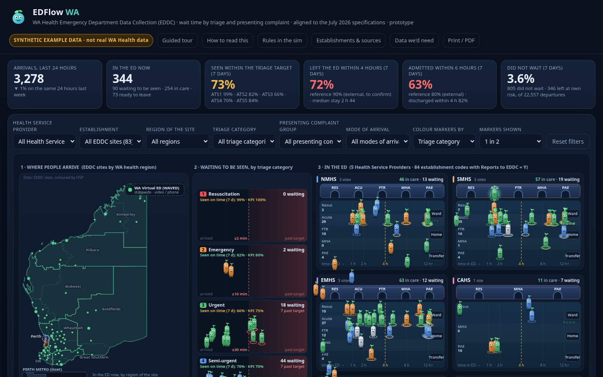
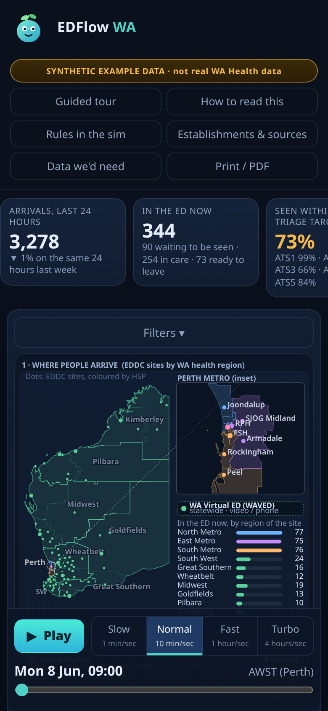

# EDFlow WA

**An animated picture of waiting times in Western Australia's public emergency departments, by triage category and presenting complaint.**

> ⚠️ **SYNTHETIC EXAMPLE DATA · not real WA Health data.** Every attendance, time and count in this demo is invented by a seeded random generator. The *structure* follows the WA Health Emergency Department Data Collection (EDDC) documents: field names, code sets and triage treatment times. The *sites and boundaries* are public reference data. Nothing here describes real activity at any hospital or any real person.

**Live demo:** https://metadata-team-member.github.io/EDFlow-WA/

**Documents:**
- [Open questions for the custodian](docs/OPEN-QUESTIONS.md)
- [Business rules summary](docs/BUSINESS-RULES-SUMMARY.md)
- [Data requirements](docs/DATA-REQUIREMENTS.md)
- [Dictionary mapping](docs/DATA-DICTIONARY-MAPPING.md)
- [Establishments (84 codes)](docs/ESTABLISHMENTS.md)
- [Sources](docs/SOURCES.md)
- [Language guide](docs/LANGUAGE-GUIDE.md)
- [Research log](docs/RESEARCH-LOG.md)
- [Contributing](CONTRIBUTING.md)



## The idea

Every small marker is one **ED attendance**. All markers have the same shape and size, with a leaf sprout. Size never encodes anything.

1. **Arriving.** A marker appears at its site on the WA map (10 health regions, with a Perth metro inset). Sites are coloured by Health Service Provider (HSP).
2. **Waiting to be seen.** The marker joins a lane for its triage category (ATS 1–5). Its position along the lane is the time waited, compared with the Business Rules treatment time: 2, 10, 30, 60 and 120 minutes (BR §7.4 Table 1). A marker past its target gets a **red ring outline** on the ground and a concerned face.
3. **In the ED.** When clinical care starts, the marker goes through a door into its HSP block. There it drifts right with its time since arrival. A dashed amber line marks 4 hours, and a marker past it gets an **amber ring outline**.
4. **Leaving.** The marker leaves through a gate: Ward (admitted), Home or Transfer. People who did not wait, or were referred at triage, leave from the waiting lane.

**Rings show the stage:**
- no ring: waiting to be seen;
- one ring: in care;
- two rings: ready to leave (Departure Ready Datetime recorded).

The simulation opens **paused**. Press **Play**, or take the **guided tour**.

## What the demo includes

* **KPI strip:**
  - arrivals in the last 24 hours;
  - people in the ED now;
  - seen within the triage target;
  - left the ED within 4 hours;
  - admitted within 6 hours;
  - did not wait.

  All of these except arrivals and people in the ED now cover the last 7 days.
* **Charts:**
  - this week, hour by hour;
  - seen within the triage target by category;
  - waiting to be seen now;
  - how people left, by HSP;
  - presenting complaint groups;
  - by region of the site;
  - when people arrive (a heatmap);
  - a "What the measures mean" panel with page references.
* **Filters:** HSP, site, region, triage category, presenting complaint group and mode of arrival. Markers can be coloured by triage, complaint group, HSP or mode, and you can choose to show 1 in N markers.
* **Click a marker** to see its synthetic attendance: times, codes and the rule used.
* **A seven-step guided tour:** the markers, arriving and waiting, time in the ED, leaving, presenting complaint, busy hours, and what is real. Every figure in it is computed from the loaded data.
* **Speed buttons** labelled with their rates: Slow 1, Normal 10, Fast 60 and Turbo 240 simulated minutes per second.
* **Print / Save as PDF.** The layout works on desktop and phone.
* **Plain HTML, CSS and JavaScript** on a canvas. No build step, no framework, no CDN, no tracking.



## What is real and what is invented

| Real (public or supplied reference) | Invented |
|---|---|
| The **84 establishment codes (83 sites)** with *Reports to EDDC = Y* in the WA Health Establishment List, May 2026 ([how this was checked](docs/ESTABLISHMENTS.md)) | Every attendance, time and outcome |
| Triage categories and their treatment times (BR §7.4) | Volumes per site: a made-up tier for each site (Q15) |
| EDDC field names and code sets (Spec Appendix B; DD 2026) | Most presenting complaint groups: placeholders until the code list is supplied (Q2) |
| The four confirmed complaint headings E, K, R and T (DD Table 1, pp.58–59) | Treatment areas (Resus, Acute, Fast track …), a display device only |
| WA health region boundaries and site positions (SLIP) | |

Not in the EDDC documents, and shown as **external, to be confirmed** (Q1):
- the performance thresholds 100 / 80 / 75 / 70 / 70 %;
- the 4-hour and 6-hour access measures.

**"Seen"** = the earlier of Doctor Seen and Nurse Seen Datetime. This follows the WA Health 2025-26 OBM KPI manual. DD p.66 mentions Nurse Seen only for WACHS (Q6).

## Run it locally

```bash
git clone https://github.com/Metadata-Team-Member/EDFlow-WA.git
cd EDFlow-WA
python3 -m http.server 8941      # or: npm run serve
# open http://localhost:8941
```

The site loads `data/synthetic.json`. You do not need Node to view it.

## Regenerate the synthetic data

This needs Node 18 or newer. The generator is seeded, so the same seed always gives the same data.

```bash
npm run data          # = node tools/generate_synthetic.mjs && node tools/build_data.mjs
# or with another seed: node tools/generate_synthetic.mjs --seed 12345 && node tools/build_data.mjs
```

Code sets, targets and complaint groups are in `config/dimensions.json`. Sites come from `data/reference/establishments.json`. Rebuild the sites with `npm run establishments`, and the map with `npm run reference`. The map rebuild needs Python with shapely 2.x.

## Plug in real data (with approval)

1. **Get approval first.** Do not commit real data, and do not host it on public GitHub Pages.
2. Produce one CSV file. Its header row must use the DD field names in [the mapping](docs/DATA-DICTIONARY-MAPPING.md), for example `est_code, arrival_datetime, triage_datetime, doctor_seen_datetime, nurse_seen, discharge_datetime, triage_category, presenting_complaint, departure_status, …`.
3. Build it:

   ```bash
   node tools/build_data.mjs --in extract.csv --out data/real.json --real
   ```

   The build prints notes on every row it skipped or corrected. `data/real*.json` is git-ignored.
4. Open `index.html?data=real.json` from a private server. The badge changes to "Real extract (approved use only)".

`npm run test:real` checks the loader against a small hand-made CSV. The loader has **never been run on a real extract**, so treat the first real run as a trial.

URL options:
- `?autoplay=1`;
- `?speed=60` (simulated minutes per second);
- `?density=3` (show 1 in N markers);
- `?color=ats|grp|hsp|mode`;
- `?tour=1`;
- `?data=file.json`.

## Project layout

```
index.html              page
css/style.css           styles
js/data.js              loads and indexes the data file; measures
js/sprites.js           the markers (one shape, rings for stage)
js/scene.js             canvas scene: map, triage lanes, HSP blocks, gates, playback
js/charts.js            charts
js/tour.js              guided tour
js/ui.js                filters, KPIs, controls, click card
config/dimensions.json  code sets, targets, complaint groups, invented volume model
tools/                  generator, loader, reference-data builders, real-mode test
data/synthetic.json     what the site loads (synthetic)
data/reference/         establishments and boundaries
docs/                   sources, rules, mapping, open questions, requirements, language, research log
```

## Honest limits

* The activity is synthetic. It shows no real patterns, and no conclusions should be drawn about real EDs.
* **The presenting complaint code list is not in the EDDC documents.** Only four headings and one example code are confirmed. The rest are placeholders (Q2).
* **Targets and thresholds** beyond the BR treatment times are external (Q1). The rule for when someone counts as seen is open (Q6).
* **HSP, region and coordinates are not in the Establishment List.** They come from SLIP and the CRS page. Three positions are approximate (⚑).
* WAVED (0123) is shown as a virtual site and is left out of the time-in-ED measures (Q11). Peel 0645 is treated as an alias of 0145 (Q4).
* The markers are a visual device. Do not use the picture to make decisions about any person or service.

## Attribution and licence

* Code: MIT. See [LICENSE](LICENSE).
* Establishment and boundary data: © Government of Western Australia, Department of Health, via SLIP (Landgate) / data.wa.gov.au (HEALTH-001, HEALTH-002). Boundaries are simplified for display.
* EDDC documents: © WA Department of Health. Only short cited excerpts are quoted. The PDFs are not in this repository.
* "WA Health" and "EDDC" belong to the Western Australian Department of Health. This is an independent prototype and is not endorsed by it.
